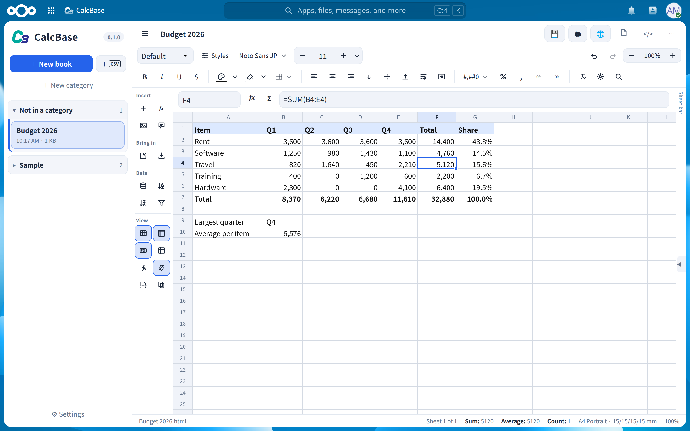
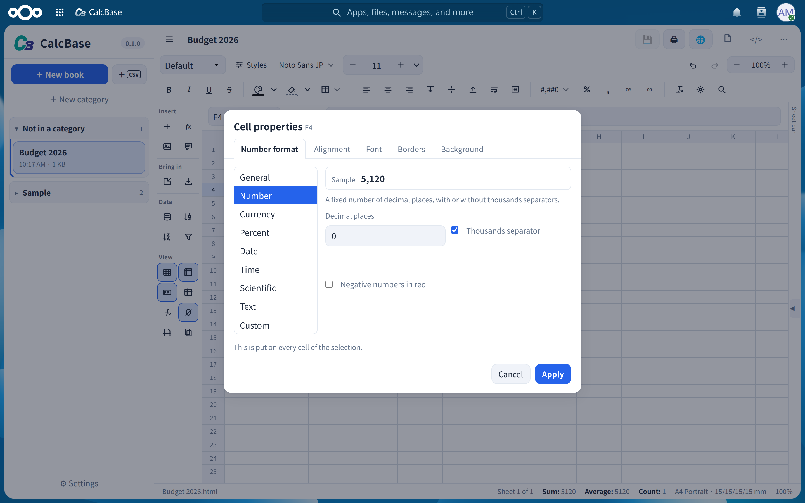
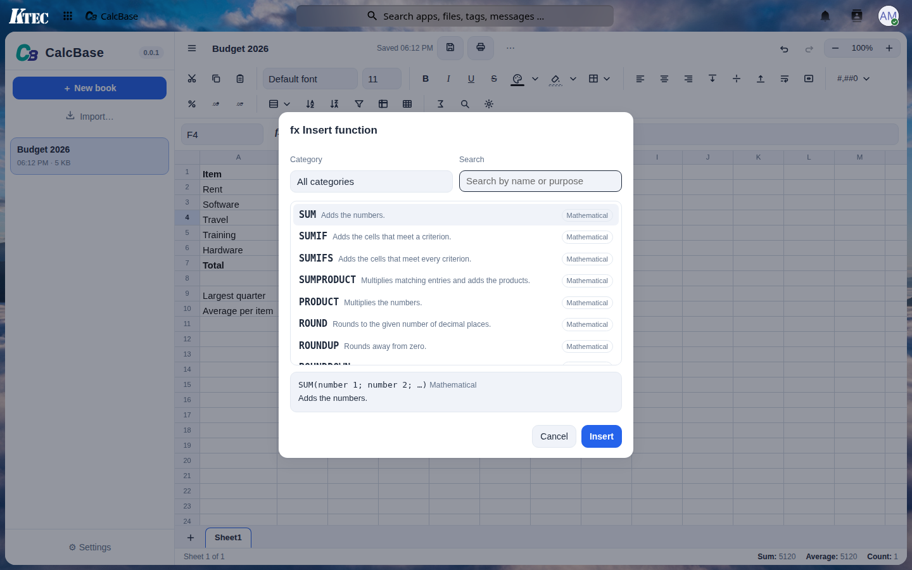
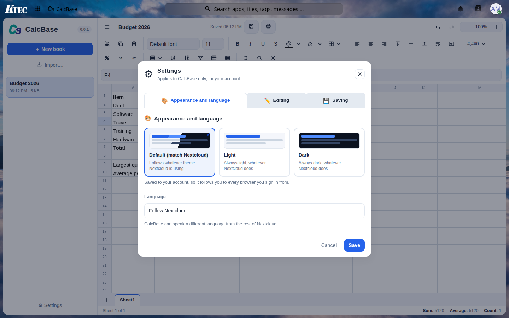
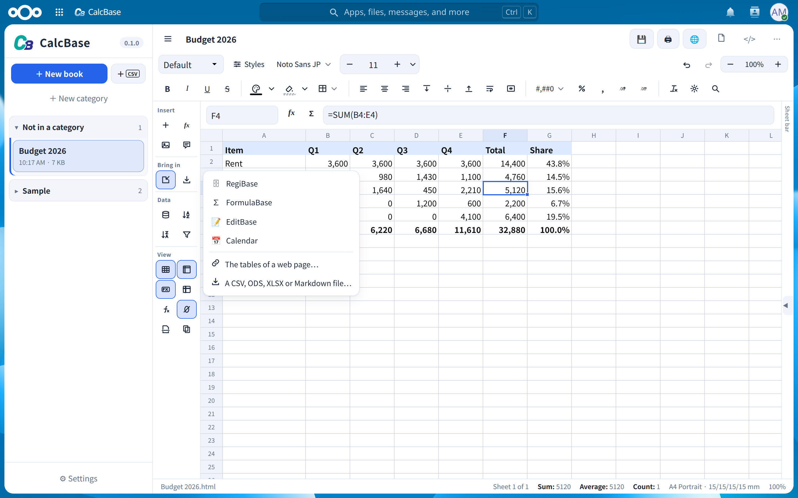

# CalcBase 📊

**A spreadsheet for Nextcloud whose workbooks are ordinary web pages.**
**Nextcloud で使える表計算アプリです。作ったブックは、そのまま普通の Web ページになります。**

> A personal project, written for my own use and shared in case it is useful to someone.
> Self-hosted; your data stays in your own Nextcloud.
> 自分で使うために作った個人プロジェクトです。どなたかのお役に立てればと思い、公開しています。
> セルフホスト型なので、データはお使いの Nextcloud の中にだけ保存されます。

[English ↓](#english) · [日本語 ↓](#japanese)

---

<a id="english"></a>

## English

### What it is

CalcBase saves every workbook as a single self-contained `.html` file in your own
Files. Each sheet is an HTML table holding what every cell shows, with the formula,
the exact value and the number format kept beside it in the cell's attributes. The
file opens and reads correctly in any browser, on any device, without CalcBase —
and CalcBase opens it again as a live spreadsheet.

It is the spreadsheet of the same series as [EditBase](https://github.com/ktec-nc-apps/EditBase),
the word processor that writes plain HTML, and it is built the same way: HTML5 and
CSS first, JavaScript only for what they cannot do (here: calculating).

CalcBase is derived from EditBase, the word processor that writes plain HTML: its screen and its way of
keeping a document as an ordinary HTML file follow EditBase's, and it can bring in the tables of EditBase
documents.

With the free [AI-Hub](https://github.com/ktec-nc-apps/AI-Hub) app, CalcBase can also use a large language
model (LLM) as an assistant: it explains and writes formulas and changes cells when asked, every change
undoable. The AI service and its key are set once in AI-Hub, and the assistant stays off until the
administrator turns it on.

### Features

- **Formulas as LibreOffice Calc writes them** — `=SUM(B2:B5)`, `=VLOOKUP(A2;Prices.A:B;2;0)`,
  `=IF(C2>0,"yes","no")`; `,` or `;` between arguments, references to other sheets as
  `Sheet2.A1` or `Sheet2!A1`, `$` for absolute references, whole columns and rows.
- **494 functions** — maths, statistics, logic, text, lookup, date and time (Japanese
  era dates included), information and finance. Where LibreOffice Calc and Excel
  differ, Calc is followed; the engine's test suite (3,563 checks, many of them
  LibreOffice 24.2's own answers) passes.
- **A grid that draws only what is on screen**, and recalculates only what a change
  affects. CalcBase is for tables kept by hand, not for bulk data: a book holds 100,000
  cells by default, a sheet 30,000 rows and a file 24 MB; the limit can be raised in the
  settings, at your own risk.
- Working as in Calc: typing, Enter and Tab, editing in the cell or the formula bar,
  pointing at cells while writing a formula, F4 for `$`, selection with the mouse and
  the keyboard, copy and paste (to and from LibreOffice, Excel and Google Sheets),
  the fill handle (series and formulas), insert and delete rows and columns (formulas
  follow), undo and redo, find and replace.
- Number formats (number, currency, percent, date, time, text, your own codes), fonts,
  bold, italic, underline, colours, fill, borders, alignment, wrapping, merged cells,
  column widths and row heights, freeze panes, sort and an autofilter.
- Several sheets in a book, renamed, moved and copied from their tabs.
- **Import** CSV/TSV (UTF-8 or Shift_JIS), ODS and XLSX; **export** CSV, ODS and XLSX,
  formulas included. Import also from the other apps of the series and from Nextcloud:
  RegiBase, FormulaBase, EditBase, NetBase, Tables, Contacts, Calendar, a web page and a
  Markdown file.
- Versions kept beside the workbook (`Book.#01.html` …), autosave, and printing the
  sheet or the selection with a page setup.
- An **AI assistant**, through the [AI-Hub](https://github.com/ktec-nc-apps/AI-Hub) app:
  a chat beside the sheet that knows spreadsheets, explains and writes formulas, and
  changes cells when asked (every change undoable). Off until the administrator turns
  it on, for everyone or for chosen groups.
- Light and dark themes, Japanese and English, and a layout for phones.

### The file it writes

```html
<section class="cb-sheet" data-name="Sheet1">
  <table>
    <tr><td data-t="s">Total</td>
        <td data-f="=SUM(B2:B5)" data-t="n" data-v="1234.5" data-fmt="#,##0.00"
            style="font-weight:700">1,234.50</td></tr>
  </table>
</section>
```

### What it does not do (yet)

Charts, pivot tables, conditional formatting, data validation, array formulas
(Ctrl+Shift+Enter), macros, and editing the same workbook by several people at once.

### Requirements

- Nextcloud 30 – 35
- PHP 8.1 or later
- For the AI assistant: the [AI-Hub](https://github.com/ktec-nc-apps/AI-Hub) app

### Installation

Copy the app into your Nextcloud's `apps` folder as `calcbase` and enable it:

```sh
sudo -u www-data php occ app:enable calcbase
```

### Status

0.1.0 — the first public release.

<a id="japanese"></a>

## 日本語

### 概要

CalcBase は、ブックを1つの `.html` ファイルとして、ご自身の Files に保存します。各シートは HTML の表で、セルには表示される値に加えて、数式・正確な値・表示形式がセルの属性として保存されます。そのため CalcBase がなくても、どの端末のブラウザーでも表として正しく表示でき、CalcBase で開けば再び計算できる表として使えます。

標準の HTML で文書を保存するワープロ [EditBase](https://github.com/ktec-nc-apps/EditBase) と同じシリーズの表計算アプリで、設計方針も同じです。HTML5 と CSS を基本とし、JavaScript は HTML と CSS ではできないこと（CalcBase では計算）にだけ使います。

CalcBase は EditBase から派生したアプリです。画面構成や、データを普通の HTML ファイルとして保存する仕組みは EditBase と共通で、EditBase の文書に含まれる表を取り込むこともできます。

無料の [AI-Hub](https://github.com/ktec-nc-apps/AI-Hub) アプリを入れると、大規模言語モデル（LLM）をアシスタントとして使えます。数式の説明や作成のほか、頼めばセルの内容を変更します（変更はすべて元に戻せます）。AI サービスと API キーは AI-Hub で一度設定するだけです。アシスタントは、管理者が有効にするまで使えません。

### 主な機能

- **LibreOffice Calc と同じ書き方の数式**：`=SUM(B2:B5)`、`=VLOOKUP(A2;価格.A:B;2;0)`、`=IF(C2>0,"はい","いいえ")` など。引数の区切りには `,` と `;` のどちらも使えます。ほかのシートは `Sheet2.A1` または `Sheet2!A1` で参照でき、`$` による絶対参照や、列全体・行全体の指定にも対応しています。
- **494 種類の関数**：数学、統計、論理、文字列、検索/行列、日付/時刻（和暦を含む）、情報、財務。LibreOffice Calc と Excel で動作が異なる場合は Calc に合わせています。計算エンジンのテスト（3,563 項目。その多くは LibreOffice 24.2 の実際の計算結果と照合）にすべて合格しています。
- **画面に表示されている部分だけを描画するグリッド**で、変更の影響を受けるセルだけを再計算します。CalcBase は手入力で管理する表のためのアプリで、大量のデータの処理には向きません。既定の上限は 1ブック 10万セル、1シート 3万行、1ファイル 24 MB です。上限は設定で引き上げられます（自己責任）。
- Calc と同じ操作感：入力、Enter キーと Tab キー、セル内や数式バーでの編集、数式の入力中にセルをクリックして参照を入力、F4 で `$` を付ける、マウスとキーボードでの選択、コピーと貼り付け（LibreOffice・Excel・Google スプレッドシートとの間でも可能）、フィルハンドル（連続データと数式）、行と列の挿入と削除（数式も追従）、元に戻す／やり直し、検索と置換。
- 表示形式（数値、通貨、パーセント、日付、時刻、文字列、ユーザー定義）、フォント、太字・斜体・下線、文字色、塗りつぶし、罫線、配置、折り返し、セルの結合、列の幅と行の高さ、ウィンドウ枠の固定、並べ替え、オートフィルター。
- 1つのブックに複数のシートを作成でき、シート見出しから名前の変更・移動・コピーができます。
- **取り込み**：CSV/TSV（UTF-8 または Shift_JIS）、ODS、XLSX。**書き出し**：CSV、ODS、XLSX（数式も含む）。同じシリーズのアプリや Nextcloud のアプリからも取り込めます（RegiBase、FormulaBase、EditBase、NetBase、Tables、連絡先、カレンダー、Web ページ、Markdown ファイル）。
- バージョンをブックと同じ場所に保存（`ブック.#01` …）、自動保存、用紙設定に従ったシートまたは選択範囲の印刷。
- [AI-Hub](https://github.com/ktec-nc-apps/AI-Hub) アプリを使った **AI アシスタント**：シートの横に表計算に詳しいチャットが表示され、数式の説明や作成、頼まれたセルの変更を行います（変更はすべて元に戻せます）。管理者が有効にするまでは使えません。利用は全員、または選んだグループだけに許可できます。
- ライト／ダークテーマ、日本語・英語に対応、スマートフォン向けのレイアウト。

### 保存されるファイル

```html
<section class="cb-sheet" data-name="Sheet1">
  <table>
    <tr><td data-t="s">合計</td>
        <td data-f="=SUM(B2:B5)" data-t="n" data-v="1234.5" data-fmt="#,##0.00"
            style="font-weight:700">1,234.50</td></tr>
  </table>
</section>
```

### まだできないこと

グラフ、ピボットテーブル、条件付き書式、入力規則、配列数式（Ctrl+Shift+Enter）、マクロ、同じブックの複数人での同時編集。

### 動作要件

- Nextcloud 30 〜 35
- PHP 8.1 以上
- AI アシスタントを使う場合：[AI-Hub](https://github.com/ktec-nc-apps/AI-Hub) アプリ

### インストール

アプリを Nextcloud の `apps` フォルダーに `calcbase` という名前でコピーし、有効にします：

```sh
sudo -u www-data php occ app:enable calcbase
```

### 現在の状態

0.1.0 ― 最初の公開バージョンです。

## Screenshots

| | |
|---|---|
|  |  |
| A sheet with formulas / 数式の入ったシート | Cell properties / セルのプロパティ |
|  |  |
| Insert function / 関数の挿入 | Settings / 設定 |
|  | |
| Bring in sheets from the other apps / ほかのアプリからシートを取り込む | |

## Licence

[AGPL-3.0-or-later](LICENSE) · © KTEC
